# ad_spend_attribution

Channel spend per customer from two ad platforms

| Setting | Value |
| --- | --- |
| Owner | marketing-data |
| Schedule | `30 5 * * *` (At 05:30) |
| Timezone | UTC |
| Warehouse | Postgres |
| Raw / staging schema | `raw` / `staging` |
| Retries | 2 (every 5 min) |
| Start date | 2026-01-01 |
| Tags | marketing |

## Diagram

```mermaid
flowchart LR
    every_morning(["<b>every_morning</b><br/>Schedule<br/><small>30 5 * * *</small>"])
    wait_for_google_ads(["<b>wait_for_google_ads</b><br/>Wait for file<br/><small>gcs: google/{ds}/</small>"])
    ads_google[("<b>ads_google</b><br/>GCS files<br/><small>gs://acme-ads/google/{ds}/ · csv</small>")]
    ads_meta[("<b>ads_meta</b><br/>S3 files<br/><small>s3://acme-ads-meta/exports/{ds}/ · json</small>")]
    customers[("<b>customers</b><br/>MySQL table<br/><small>shop.customers</small>")]
    ad_spend["<b>ad_spend</b><br/>Union<br/><small>union all</small>"]
    spend_with_customers["<b>spend_with_customers</b><br/>Join<br/><small>inner join on customer_id</small>"]
    spend_by_channel["<b>spend_by_channel</b><br/>Pivot<br/><small>channel → search, social, video</small>"]
    has_rows{{"<b>has_rows</b><br/>Row count range<br/><small>1 – 5000000 rows</small>"}}
    no_negative_spend{{"<b>no_negative_spend</b><br/>Custom SQL check<br/><small>select * from {{ input }} where search #lt; 0 or social #lt; 0 or </small>"}}
    is_weekday(["<b>is_weekday</b><br/>Branch<br/><small>if run_date.weekday() #lt; 5</small>"])
    export_parquet[/"<b>export_parquet</b><br/>S3 Parquet<br/><small>s3://acme-exports/attribution/dt={ds}/</small>"/]
    weekend_scoring["<b>weekend_scoring</b><br/>Python function<br/><small>pandas transform</small>"]
    weekend_scores[/"<b>weekend_scores</b><br/>Warehouse table<br/><small>marketing.weekend_scores · overwrite</small>"/]
    sla_90m(["<b>sla_90m</b><br/>SLA<br/><small>within 90 min</small>"])
    every_morning --> wait_for_google_ads
    wait_for_google_ads --> ads_google
    ads_google --> ad_spend
    ads_meta --> ad_spend
    ad_spend -->|left| spend_with_customers
    customers -->|right| spend_with_customers
    spend_with_customers --> spend_by_channel
    spend_by_channel --> has_rows
    has_rows --> no_negative_spend
    no_negative_spend --> is_weekday
    is_weekday -->|yes| export_parquet
    is_weekday -->|no| weekend_scoring
    weekend_scoring --> weekend_scores
    export_parquet --> sla_90m
    weekend_scores --> sla_90m
    classDef source fill:#22c55e22,stroke:#22c55e,stroke-width:2px
    classDef transform fill:#3b82f622,stroke:#3b82f6,stroke-width:2px
    classDef quality fill:#eab30822,stroke:#eab308,stroke-width:2px
    classDef sink fill:#a855f722,stroke:#a855f7,stroke-width:2px
    classDef control fill:#94a3b822,stroke:#94a3b8,stroke-width:2px
    class ads_google,ads_meta,customers source
    class ad_spend,spend_with_customers,spend_by_channel,weekend_scoring transform
    class has_rows,no_negative_spend quality
    class export_parquet,weekend_scores sink
    class every_morning,wait_for_google_ads,is_weekday,sla_90m control
```



## Steps

| # | Step | Type | Details | Upstream |
| --- | --- | --- | --- | --- |
| 1 | `every_morning` | 🗓️ Schedule | 30 5 * * * | - |
| 2 | `wait_for_google_ads` | ⏳ Wait for file | gcs: google/{ds}/ | `every_morning` |
| 3 | `ads_google` | ☁️ GCS files | gs://acme-ads/google/{ds}/ · csv | `wait_for_google_ads` |
| 4 | `ads_meta` | 🪣 S3 files | s3://acme-ads-meta/exports/{ds}/ · json | - |
| 5 | `customers` | 🐬 MySQL table | shop.customers | - |
| 6 | `ad_spend` | ⋃ Union | union all | `ads_google`, `ads_meta` |
| 7 | `spend_with_customers` | 🔗 Join | inner join on customer_id | `ad_spend`, `customers` |
| 8 | `spend_by_channel` | 🔄 Pivot | channel → search, social, video | `spend_with_customers` |
| 9 | `has_rows` | #️⃣ Row count range | 1 – 5000000 rows | `spend_by_channel` |
| 10 | `no_negative_spend` | 🧪 Custom SQL check | select * from {{ input }} where search < 0 or social < 0 or  | `has_rows` |
| 11 | `is_weekday` | 🔀 Branch | if run_date.weekday() < 5 | `no_negative_spend` |
| 12 | `export_parquet` | 📦 S3 Parquet | s3://acme-exports/attribution/dt={ds}/ | `is_weekday` (yes) |
| 13 | `weekend_scoring` | 🐍 Python function | pandas transform | `is_weekday` (no) |
| 14 | `weekend_scores` | 🏛️ Warehouse table | marketing.weekend_scores · overwrite | `weekend_scoring` |
| 15 | `sla_90m` | 🚨 SLA | within 90 min | `export_parquet`, `weekend_scores` |

## Step details

### `ads_google`

Writes / reads: `raw.ads_google`

Columns: `customer_id`, `channel`, `spend`

### `ads_meta`

Writes / reads: `raw.ads_meta`

Columns: `customer_id`, `channel`, `spend`

### `customers`

Writes / reads: `raw.customers`

Columns: `customer_id`, `email`, `country`

### `ad_spend`

Writes / reads: `staging.ad_spend`

Columns: `customer_id`, `channel`, `spend`

### `spend_with_customers`

Writes / reads: `staging.spend_with_customers`

Columns: `customer_id`, `country`, `channel`, `spend`

### `spend_by_channel`

Writes / reads: `staging.spend_by_channel`

Columns: `customer_id`, `country`, `search`, `social`, `video`

### `no_negative_spend`

Columns: `customer_id`, `country`, `search`, `social`, `video`

```sql
select *
from {{ input }}
where search < 0 or social < 0 or video < 0
```

### `weekend_scoring`

Writes / reads: `staging.weekend_scoring`

```python
def transform(df, **inputs):
    """Score customers by share of social spend."""
    total = df[["search", "social", "video"]].fillna(0).sum(axis=1)
    df["social_share"] = (df["social"].fillna(0) / total.where(total > 0)).fillna(0)
    return df
```

### `weekend_scores`

Writes / reads: `marketing.weekend_scores`

## Data quality checks

- **has_rows** (Row count range) on `spend_by_channel`: 1 – 5000000 rows
- **no_negative_spend** (Custom SQL check) on `spend_by_channel`: select * from {{ input }} where search < 0 or social < 0 or 

## Alerts and SLAs

- **sla_90m**: within 90 min

## Validation

No issues found.

## Next runs (UTC)

- Fri, 2026-10-02, 05:30
- Sat, 2026-10-03, 05:30
- Sun, 2026-10-04, 05:30
- Mon, 2026-10-05, 05:30
- Tue, 2026-10-06, 05:30

---

_Generated by [PipelineSketch](https://shaikbasha1437.github.io/pipelinesketch/)._
