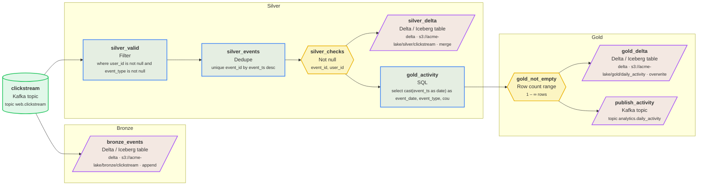

# clickstream_medallion

Micro-batch clickstream into a bronze/silver/gold Delta lake

| Setting | Value |
| --- | --- |
| Owner | platform |
| Schedule | `*/15 * * * *` (Every 15 minutes) |
| Timezone | UTC |
| Warehouse | DuckDB |
| Raw / staging schema | `raw` / `staging` |
| Retries | 2 (every 5 min) |
| Start date | 2026-01-01 |
| Tags | streaming, delta, medallion |

## Diagram



## Steps

| # | Step | Type | Details | Upstream |
| --- | --- | --- | --- | --- |
| 1 | `clickstream` | 📨 Kafka topic | topic web.clickstream | - |
| 2 | `bronze_events` | 🧊 Delta / Iceberg table | delta · s3://acme-lake/bronze/clickstream · append | `clickstream` |
| 3 | `silver_valid` | 🔎 Filter | where user_id is not null and event_type is not null | `clickstream` |
| 4 | `silver_events` | 🧹 Dedupe | unique event_id by event_ts desc | `silver_valid` |
| 5 | `silver_checks` | ∅ Not null | event_id, user_id | `silver_events` |
| 6 | `silver_delta` | 🧊 Delta / Iceberg table | delta · s3://acme-lake/silver/clickstream · merge | `silver_checks` |
| 7 | `gold_activity` | 🧮 SQL | select cast(event_ts as date) as event_date, event_type, cou | `silver_checks` |
| 8 | `gold_not_empty` | #️⃣ Row count range | 1 – ∞ rows | `gold_activity` |
| 9 | `gold_delta` | 🧊 Delta / Iceberg table | delta · s3://acme-lake/gold/daily_activity · overwrite | `gold_not_empty` |
| 10 | `publish_activity` | 📤 Kafka topic | topic analytics.daily_activity | `gold_not_empty` |

## Step details

### `clickstream`

Writes / reads: `raw.clickstream`

Columns: `event_id`, `user_id`, `event_type`, `page`, `event_ts`

### `silver_valid`

Writes / reads: `staging.silver_valid`

Columns: `event_id`, `user_id`, `event_type`, `page`, `event_ts`

### `silver_events`

Writes / reads: `staging.silver_events`

Columns: `event_id`, `user_id`, `event_type`, `page`, `event_ts`

### `gold_activity`

Writes / reads: `staging.gold_activity`

Columns: `event_date`, `event_type`, `events`, `users`

```sql
select
    cast(event_ts as date) as event_date,
    event_type,
    count(*) as events,
    count(distinct user_id) as users
from {{ input }}
group by 1, 2
```

## Data quality checks

- **silver_checks** (Not null) on `silver_events`: event_id, user_id
- **gold_not_empty** (Row count range) on `gold_activity`: 1 – ∞ rows

## Validation

No issues found.

## Next runs (UTC)

- Thu, 2026-10-01, 12:15
- Thu, 2026-10-01, 12:30
- Thu, 2026-10-01, 12:45
- Thu, 2026-10-01, 13:00
- Thu, 2026-10-01, 13:15

---

_Generated by [PipelineSketch](https://shaikbasha1437.github.io/pipelinesketch/)._
