# customers_cdc_to_bigquery

Incremental customer changes from Postgres into a BigQuery dimension

| Setting | Value |
| --- | --- |
| Owner | data-eng |
| Schedule | `@hourly` (Every hour, on the hour) |
| Timezone | UTC |
| Warehouse | BigQuery |
| Raw / staging schema | `raw` / `staging` |
| Retries | 2 (every 5 min) |
| Start date | 2026-01-01 |
| Tags | cdc, bigquery |

## Diagram

```mermaid
flowchart LR
    customers_cdc[("<b>customers_cdc</b><br/>Postgres table<br/><small>public.customers Δ updated_at</small>")]
    customers_latest["<b>customers_latest</b><br/>Dedupe<br/><small>unique customer_id by updated_at desc</small>"]
    countries[("<b>countries</b><br/>BigQuery table<br/><small>acme-analytics.reference.countries</small>")]
    customers_enriched["<b>customers_enriched</b><br/>Join<br/><small>left join on country_code</small>"]
    customer_id_not_null{{"<b>customer_id_not_null</b><br/>Not null<br/><small>customer_id</small>"}}
    customer_id_unique{{"<b>customer_id_unique</b><br/>Unique<br/><small>customer_id</small>"}}
    customers_fresh{{"<b>customers_fresh</b><br/>Freshness<br/><small>updated_at #lt; 3h old</small>"}}
    dim_customers[/"<b>dim_customers</b><br/>Warehouse table<br/><small>analytics.dim_customers · merge on customer_id</small>"/]
    page_on_failure[/"<b>page_on_failure</b><br/>Slack / email alert<br/><small>email when fails</small>"/]
    customers_cdc --> customers_latest
    customers_latest -->|left| customers_enriched
    countries -->|right| customers_enriched
    customers_enriched --> customer_id_not_null
    customer_id_not_null --> customer_id_unique
    customer_id_unique --> customers_fresh
    customers_fresh --> dim_customers
    dim_customers --> page_on_failure
    classDef source fill:#22c55e22,stroke:#22c55e,stroke-width:2px
    classDef transform fill:#3b82f622,stroke:#3b82f6,stroke-width:2px
    classDef quality fill:#eab30822,stroke:#eab308,stroke-width:2px
    classDef sink fill:#a855f722,stroke:#a855f7,stroke-width:2px
    classDef control fill:#94a3b822,stroke:#94a3b8,stroke-width:2px
    class customers_cdc,countries source
    class customers_latest,customers_enriched transform
    class customer_id_not_null,customer_id_unique,customers_fresh quality
    class dim_customers,page_on_failure sink
```

## Steps

| # | Step | Type | Details | Upstream |
| --- | --- | --- | --- | --- |
| 1 | `customers_cdc` | 🐘 Postgres table | public.customers Δ updated_at | - |
| 2 | `customers_latest` | 🧹 Dedupe | unique customer_id by updated_at desc | `customers_cdc` |
| 3 | `countries` | 🔷 BigQuery table | acme-analytics.reference.countries | - |
| 4 | `customers_enriched` | 🔗 Join | left join on country_code | `customers_latest`, `countries` |
| 5 | `customer_id_not_null` | ∅ Not null | customer_id | `customers_enriched` |
| 6 | `customer_id_unique` | ☝️ Unique | customer_id | `customer_id_not_null` |
| 7 | `customers_fresh` | ⏱️ Freshness | updated_at < 3h old | `customer_id_unique` |
| 8 | `dim_customers` | 🏛️ Warehouse table | analytics.dim_customers · merge on customer_id | `customers_fresh` |
| 9 | `page_on_failure` | 🔔 Slack / email alert | email when fails | `dim_customers` |

## Step details

### `customers_cdc`

Writes / reads: `raw.customers_cdc`

Columns: `customer_id`, `email`, `full_name`, `country_code`, `updated_at`

### `customers_latest`

Writes / reads: `staging.customers_latest`

Columns: `customer_id`, `email`, `full_name`, `country_code`, `updated_at`

### `countries`

Writes / reads: ``acme-analytics.reference.countries``

Columns: `country_code`, `country_name`, `region`

### `customers_enriched`

Writes / reads: `staging.customers_enriched`

Columns: `customer_id`, `email`, `full_name`, `country_code`, `updated_at`, `country_name`, `region`

### `dim_customers`

Writes / reads: `analytics.dim_customers`

Columns: `customer_id`, `email`, `full_name`, `country_code`, `updated_at`, `country_name`, `region`

## Data quality checks

- **customer_id_not_null** (Not null) on `customers_enriched`: customer_id
- **customer_id_unique** (Unique) on `customers_enriched`: customer_id
- **customers_fresh** (Freshness) on `customers_enriched`: updated_at < 3h old

## Alerts and SLAs

- **page_on_failure**: email when fails

## Validation

No issues found.

## Next runs (UTC)

- Thu, 2026-10-01, 13:00
- Thu, 2026-10-01, 14:00
- Thu, 2026-10-01, 15:00
- Thu, 2026-10-01, 16:00
- Thu, 2026-10-01, 17:00

---

_Generated by [PipelineSketch](https://shaikbasha1437.github.io/pipelinesketch/)._
