# daily_revenue_local

Daily revenue rollup in DuckDB

| Setting | Value |
| --- | --- |
| Owner | analytics |
| Schedule | `@daily` (At 00:00) |
| Timezone | UTC |
| Warehouse | DuckDB |
| Raw / staging schema | `raw` / `staging` |
| Retries | 2 (every 5 min) |
| Start date | 2026-01-01 |
| Tags | duckdb, iceberg |

## Diagram

```mermaid
flowchart LR
    wait_for_export(["<b>wait_for_export</b><br/>Wait for file<br/><small>local: /data/exports/{ds}/orders.done</small>"])
    orders[("<b>orders</b><br/>Postgres table<br/><small>shop.orders</small>")]
    paid_orders["<b>paid_orders</b><br/>Filter<br/><small>where status = 'paid'</small>"]
    orders_by_day["<b>orders_by_day</b><br/>Select / rename<br/><small>3 columns</small>"]
    daily_revenue["<b>daily_revenue</b><br/>Aggregate<br/><small>group by order_date</small>"]
    revenue_has_rows{{"<b>revenue_has_rows</b><br/>Row count range<br/><small>1 – ∞ rows</small>"}}
    revenue_table[/"<b>revenue_table</b><br/>Warehouse table<br/><small>analytics.daily_revenue · append</small>"/]
    revenue_iceberg[/"<b>revenue_iceberg</b><br/>Delta / Iceberg table<br/><small>iceberg · analytics.daily_revenue · append</small>"/]
    wait_for_export --> orders
    orders --> paid_orders
    paid_orders --> orders_by_day
    orders_by_day --> daily_revenue
    daily_revenue --> revenue_has_rows
    revenue_has_rows --> revenue_table
    revenue_has_rows --> revenue_iceberg
    classDef source fill:#22c55e22,stroke:#22c55e,stroke-width:2px
    classDef transform fill:#3b82f622,stroke:#3b82f6,stroke-width:2px
    classDef quality fill:#eab30822,stroke:#eab308,stroke-width:2px
    classDef sink fill:#a855f722,stroke:#a855f7,stroke-width:2px
    classDef control fill:#94a3b822,stroke:#94a3b8,stroke-width:2px
    class orders source
    class paid_orders,orders_by_day,daily_revenue transform
    class revenue_has_rows quality
    class revenue_table,revenue_iceberg sink
    class wait_for_export control
```

## Steps

| # | Step | Type | Details | Upstream |
| --- | --- | --- | --- | --- |
| 1 | `wait_for_export` | ⏳ Wait for file | local: /data/exports/{ds}/orders.done | - |
| 2 | `orders` | 🐘 Postgres table | shop.orders | `wait_for_export` |
| 3 | `paid_orders` | 🔎 Filter | where status = 'paid' | `orders` |
| 4 | `orders_by_day` | ✂️ Select / rename | 3 columns | `paid_orders` |
| 5 | `daily_revenue` | ∑ Aggregate | group by order_date | `orders_by_day` |
| 6 | `revenue_has_rows` | #️⃣ Row count range | 1 – ∞ rows | `daily_revenue` |
| 7 | `revenue_table` | 🏛️ Warehouse table | analytics.daily_revenue · append | `revenue_has_rows` |
| 8 | `revenue_iceberg` | 🧊 Delta / Iceberg table | iceberg · analytics.daily_revenue · append | `revenue_has_rows` |

## Step details

### `orders`

Writes / reads: `raw.orders`

Columns: `order_id`, `customer_id`, `amount`, `status`, `created_at`

### `paid_orders`

Writes / reads: `staging.paid_orders`

Columns: `order_id`, `customer_id`, `amount`, `status`, `created_at`

### `orders_by_day`

Writes / reads: `staging.orders_by_day`

Columns: `order_id`, `amount`, `order_date`

### `daily_revenue`

Writes / reads: `staging.daily_revenue`

Columns: `order_date`, `orders`, `revenue`

### `revenue_table`

Writes / reads: `analytics.daily_revenue`

Columns: `order_date`, `orders`, `revenue`

## Data quality checks

- **revenue_has_rows** (Row count range) on `daily_revenue`: 1 – ∞ rows

## Validation

No issues found.

## Next runs (UTC)

- Fri, 2026-10-02, 00:00
- Sat, 2026-10-03, 00:00
- Sun, 2026-10-04, 00:00
- Mon, 2026-10-05, 00:00
- Tue, 2026-10-06, 00:00

---

_Generated by [PipelineSketch](https://shaikbasha1437.github.io/pipelinesketch/)._
