# s3_to_snowflake_orders

Daily orders ELT from S3 into Snowflake

| Setting | Value |
| --- | --- |
| Owner | data-eng |
| Schedule | `0 6 * * *` (At 06:00) |
| Timezone | UTC |
| Warehouse | Snowflake |
| Raw / staging schema | `raw` / `staging` |
| Retries | 2 (every 5 min) |
| Start date | 2026-01-01 |
| Tags | orders, elt, snowflake |
| Failure email | data-oncall@example.com |

## Diagram

```mermaid
flowchart LR
    wait_for_orders(["<b>wait_for_orders</b><br/>Wait for file<br/><small>s3: orders/{ds}/_SUCCESS</small>"])
    orders_raw[("<b>orders_raw</b><br/>S3 files<br/><small>s3://acme-landing/orders/{ds}/ · parquet</small>")]
    fct_orders[/"<b>fct_orders</b><br/>Warehouse table<br/><small>analytics.fct_orders · merge on order_id</small>"/]
    notify_success[/"<b>notify_success</b><br/>Slack / email alert<br/><small>slack when succeeds</small>"/]
    notify_failure[/"<b>notify_failure</b><br/>Slack / email alert<br/><small>email when fails</small>"/]
    sla_2h(["<b>sla_2h</b><br/>SLA<br/><small>within 120 min</small>"])
    subgraph grp_staging_1["Staging"]
        stg_orders["<b>stg_orders</b><br/>Select / rename<br/><small>5 columns</small>"]
        orders_dedup["<b>orders_dedup</b><br/>Dedupe<br/><small>unique order_id by updated_at desc</small>"]
    end
    subgraph grp_data_tests_2["Data tests"]
        orders_not_null{{"<b>orders_not_null</b><br/>Not null<br/><small>order_id, customer_id</small>"}}
        orders_unique{{"<b>orders_unique</b><br/>Unique<br/><small>order_id</small>"}}
        status_values{{"<b>status_values</b><br/>Accepted values<br/><small>status in (placed, shipped, delivered, returned)</small>"}}
    end
    wait_for_orders --> orders_raw
    orders_raw --> stg_orders
    stg_orders --> orders_dedup
    orders_dedup --> orders_not_null
    orders_not_null --> orders_unique
    orders_unique --> status_values
    status_values --> fct_orders
    fct_orders --> notify_success
    fct_orders --> notify_failure
    fct_orders --> sla_2h
    classDef source fill:#22c55e22,stroke:#22c55e,stroke-width:2px
    classDef transform fill:#3b82f622,stroke:#3b82f6,stroke-width:2px
    classDef quality fill:#eab30822,stroke:#eab308,stroke-width:2px
    classDef sink fill:#a855f722,stroke:#a855f7,stroke-width:2px
    classDef control fill:#94a3b822,stroke:#94a3b8,stroke-width:2px
    class orders_raw source
    class stg_orders,orders_dedup transform
    class orders_not_null,orders_unique,status_values quality
    class fct_orders,notify_success,notify_failure sink
    class wait_for_orders,sla_2h control
```

## Steps

| # | Step | Type | Details | Upstream |
| --- | --- | --- | --- | --- |
| 1 | `wait_for_orders` | ⏳ Wait for file | s3: orders/{ds}/_SUCCESS | - |
| 2 | `orders_raw` | 🪣 S3 files | s3://acme-landing/orders/{ds}/ · parquet | `wait_for_orders` |
| 3 | `stg_orders` | ✂️ Select / rename | 5 columns | `orders_raw` |
| 4 | `orders_dedup` | 🧹 Dedupe | unique order_id by updated_at desc | `stg_orders` |
| 5 | `orders_not_null` | ∅ Not null | order_id, customer_id | `orders_dedup` |
| 6 | `orders_unique` | ☝️ Unique | order_id | `orders_not_null` |
| 7 | `status_values` | ✅ Accepted values | status in (placed, shipped, delivered, returned) | `orders_unique` |
| 8 | `fct_orders` | 🏛️ Warehouse table | analytics.fct_orders · merge on order_id | `status_values` |
| 9 | `notify_success` | 🔔 Slack / email alert | slack when succeeds | `fct_orders` |
| 10 | `notify_failure` | 🔔 Slack / email alert | email when fails | `fct_orders` |
| 11 | `sla_2h` | 🚨 SLA | within 120 min | `fct_orders` |

## Step details

### `orders_raw`

Writes / reads: `raw.orders_raw`

Columns: `order_id`, `customer_id`, `status`, `amount`, `updated_at`

### `stg_orders`

Writes / reads: `staging.stg_orders`

Columns: `order_id`, `customer_id`, `status`, `amount`, `updated_at`

### `orders_dedup`

Writes / reads: `staging.orders_dedup`

Columns: `order_id`, `customer_id`, `status`, `amount`, `updated_at`

### `fct_orders`

Writes / reads: `analytics.fct_orders`

Columns: `order_id`, `customer_id`, `status`, `amount`, `updated_at`

## Data quality checks

- **orders_not_null** (Not null) on `orders_dedup`: order_id, customer_id
- **orders_unique** (Unique) on `orders_dedup`: order_id
- **status_values** (Accepted values) on `orders_dedup`: status in (placed, shipped, delivered, returned)

## Alerts and SLAs

- **notify_success**: slack when succeeds
- **notify_failure**: email when fails
- **sla_2h**: within 120 min

## Validation

No issues found.

## Next runs (UTC)

- Fri, 2026-10-02, 06:00
- Sat, 2026-10-03, 06:00
- Sun, 2026-10-04, 06:00
- Mon, 2026-10-05, 06:00
- Tue, 2026-10-06, 06:00

---

_Generated by [PipelineSketch](https://shaikbasha1437.github.io/pipelinesketch/)._
