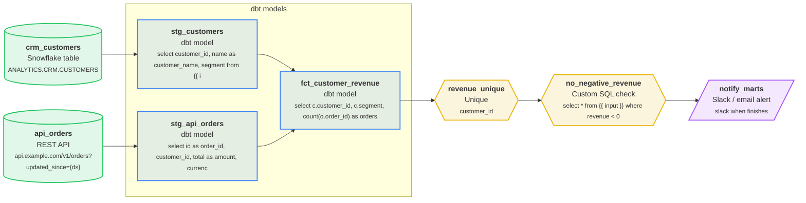

# shop_api_to_marts

Orders from the shop API modelled with dbt

| Setting | Value |
| --- | --- |
| Owner | analytics-eng |
| Schedule | `0 7 * * *` (At 07:00) |
| Timezone | UTC |
| Warehouse | Snowflake |
| Raw / staging schema | `raw` / `staging` |
| Retries | 2 (every 5 min) |
| Start date | 2026-01-01 |
| Tags | api, dbt |

## Diagram



## Steps

| # | Step | Type | Details | Upstream |
| --- | --- | --- | --- | --- |
| 1 | `api_orders` | 🌐 REST API | api.example.com/v1/orders?updated_since={ds} | - |
| 2 | `crm_customers` | ❄️ Snowflake table | ANALYTICS.CRM.CUSTOMERS | - |
| 3 | `stg_api_orders` | 🟧 dbt model | select id as order_id, customer_id, total as amount, currenc | `api_orders` |
| 4 | `stg_customers` | 🟧 dbt model | select customer_id, name as customer_name, segment from {{ i | `crm_customers` |
| 5 | `fct_customer_revenue` | 🟧 dbt model | select c.customer_id, c.segment, count(o.order_id) as orders | `stg_customers`, `stg_api_orders` |
| 6 | `revenue_unique` | ☝️ Unique | customer_id | `fct_customer_revenue` |
| 7 | `no_negative_revenue` | 🧪 Custom SQL check | select * from {{ input }} where revenue < 0 | `revenue_unique` |
| 8 | `notify_marts` | 🔔 Slack / email alert | slack when finishes | `no_negative_revenue` |

## Step details

### `api_orders`

Writes / reads: `raw.api_orders`

Columns: `id`, `customer_id`, `total`, `currency`, `created_at`

### `crm_customers`

Writes / reads: `ANALYTICS.CRM.CUSTOMERS`

Columns: `customer_id`, `name`, `segment`

### `stg_api_orders`

Writes / reads: `staging.stg_api_orders`

Columns: `order_id`, `customer_id`, `amount`, `currency`, `created_at`

```sql
select
    id as order_id,
    customer_id,
    total as amount,
    currency,
    created_at
from {{ input }}
```

### `stg_customers`

Writes / reads: `staging.stg_customers`

Columns: `customer_id`, `customer_name`, `segment`

```sql
select
    customer_id,
    name as customer_name,
    segment
from {{ input }}
```

### `fct_customer_revenue`

Writes / reads: `staging.fct_customer_revenue`

Columns: `customer_id`, `segment`, `orders`, `revenue`

```sql
select
    c.customer_id,
    c.segment,
    count(o.order_id) as orders,
    coalesce(sum(o.amount), 0) as revenue
from {{ input }} as c
left join {{ input_2 }} as o
    on o.customer_id = c.customer_id
group by 1, 2
```

### `no_negative_revenue`

Columns: `customer_id`, `segment`, `orders`, `revenue`

```sql
select *
from {{ input }}
where revenue < 0
```

## Data quality checks

- **revenue_unique** (Unique) on `fct_customer_revenue`: customer_id
- **no_negative_revenue** (Custom SQL check) on `fct_customer_revenue`: select * from {{ input }} where revenue < 0

## Alerts and SLAs

- **notify_marts**: slack when finishes

## Validation

No issues found.

## Next runs (UTC)

- Fri, 2026-10-02, 07:00
- Sat, 2026-10-03, 07:00
- Sun, 2026-10-04, 07:00
- Mon, 2026-10-05, 07:00
- Tue, 2026-10-06, 07:00

---

_Generated by [PipelineSketch](https://shaikbasha1437.github.io/pipelinesketch/)._
